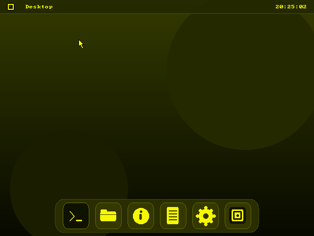
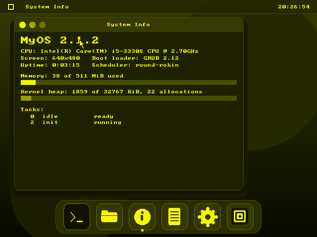
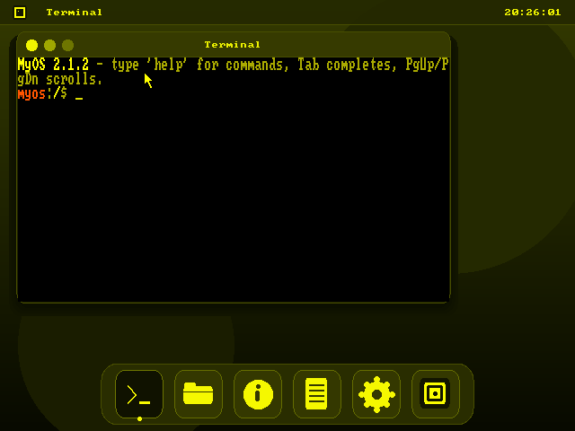
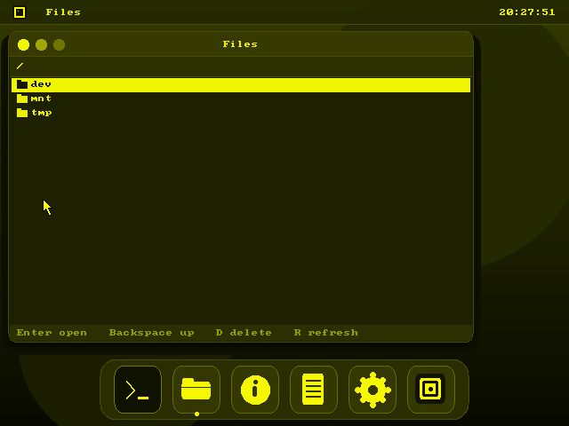

# MyOS 2.1.2 "Horizon"

**A hobby operating system built from scratch in C and x86 assembly.**

MyOS is a 32-bit x86 operating system designed to explore kernel development, memory management, multitasking, filesystems, device drivers, graphics, and graphical user interfaces.

The project boots through GRUB using the Multiboot protocol and is organized into separate kernel subsystems, making it easier to understand, extend, and experiment with operating-system internals.

           

**Repository:** arshc0der/myOS · **License:** MIT

---

## Table of Contents

- Overview
- Features
- Screenshots and Demo
- Getting Started
- Building MyOS
- Running MyOS
- Using the Shell
- Filesystems
- Memory Management and Processes
- Graphics and Desktop
- Project Structure
- Write Your Own Code
- Documentation
- Testing
- Troubleshooting
- Roadmap
- Contributing
- License

## Overview

MyOS started as a small kernel with a text console and an interactive shell. Version 2.0.0, named **Foundation**, organizes the code into dedicated components for architecture, device drivers, memory management, filesystems, process scheduling, graphics, and user extensions.

The goal is to build an operating system that is both a practical programming project and an educational platform.

You can study how a kernel boots, inspect hardware information, experiment with memory allocation, explore virtual filesystems, implement scheduler policies, and write your own filesystem.

## Features

The following list describes the subsystems present in the project source tree. The completeness and stability of individual features may vary.

### Kernel and hardware

- GRUB boot support using the Multiboot protocol.
- 32-bit x86 kernel written in C and assembly.
- Global Descriptor Table (GDT) and Interrupt Descriptor Table (IDT).
- Interrupt service routines and programmable interrupt controller (PIC) support.
- Programmable Interval Timer (PIT).
- CPU information through CPUID.
- PCI device enumeration.
- PS/2 keyboard and mouse input.
- Real-time clock (RTC).
- Serial and VGA console drivers.
- Kernel logging, formatted output, and panic handling.

### Memory management

- Physical memory management with a bitmap allocator.
- Virtual memory management and paging.
- Kernel heap allocator.
- Memory-related diagnostic interfaces.

### Processes and synchronization

- Scheduler subsystem with configurable policies.
- Context-switching support.
- Mutexes, semaphores, and synchronization primitives.
- Student scheduler implementation.

### Filesystems and storage

- Virtual filesystem (VFS).
- RAM-based filesystem (ramfs).
- Device filesystem (devfs).
- Project filesystem (MyFS).
- Block-device abstraction.
- RAM disks.
- ATA PIO disk driver.
- MBR partition support.
- Filesystem mounting and file operations through the shell.

### Graphics and desktop

- Framebuffer graphics support.
- Framebuffer-based text console.
- Graphics primitives and terminal grid.
- Graphical user interface subsystem.
- Desktop applications and window management, where implemented and enabled in the current build.

### Developer tools

- Modular shell commands.
- Built-in kernel self-tests.
- Host-side test infrastructure.
- Student templates for custom initialization, filesystems, and scheduling.
- Architecture and subsystem documentation.

## Screenshots






## Getting Started

### Requirements

A Linux development environment is recommended.

| Tool | Purpose |
| --- | --- |
| GCC with 32-bit support | Compile kernel code |
| GNU Make | Build automation |
| GNU binutils | Assemble and link the kernel |
| GRUB utilities | Prepare a bootable ISO |
| xorriso | Create the ISO image |
| QEMU | Run and debug MyOS |
| Bochs | Alternative emulator and debugging environment |

The exact toolchain requirements depend on the compiler flags and targets configured in the `Makefile`.

### Fedora

Install the commonly required development tools:

bash

```
sudo dnf install gcc glibc-devel.i686 make binutils \
  qemu-system-x86 grub2-tools grub2-tools-extra xorriso
```

### Debian / Ubuntu

bash

```
sudo apt update
sudo apt install build-essential gcc-multilib binutils make \
  grub-pc-bin xorriso mtools qemu-system-x86
```

If your distribution uses different GRUB package names, install the equivalent packages for your release.

## Building MyOS

Clone the repository and enter the project directory:

bash

```
git clone https://github.com/arshc0der/myOS.git
cd myOS
```

Inspect the available build targets:

bash

```
make help
```

If the Makefile does not define a `help` target, inspect the available targets directly:

bash

```
grep -nE '^[[:alnum:]_.-]+:' Makefile
```

### Compile the kernel

bash

```
make clean
make
```

The expected kernel output is `kernel.elf`, based on the project's existing build instructions.

### Build the bootable ISO

bash

```
make iso
```

The ISO output is expected to be `myos.iso`.

### Run in QEMU

bash

```
make run
```

If you prefer to launch QEMU manually after building the ISO:

bash

```
qemu-system-i386 -cdrom myos.iso -m 128M
```

The commands above follow the project's earlier build workflow. If the current Makefile uses different target names or output paths, follow the definitions in that file.

## Running MyOS

### QEMU

QEMU provides a convenient way to test the operating system without modifying your host system.

A basic launch command is:

bash

```
qemu-system-i386 -cdrom myos.iso -m 128M
```

You can experiment with different RAM sizes and virtual hardware configurations as kernel support improves.

### VirtualBox and VMware

Create a virtual machine configured for a 32-bit x86 guest, attach the bootable ISO, and boot from the virtual optical drive.

Compatibility depends on the firmware mode and devices exposed to the guest.

### Bochs

Bochs can be useful for low-level debugging and examining processor state. The repository includes a Bochs configuration and a test script under `tools/bochs/`.

Review those files for the expected image paths and launch procedure.

### Real hardware

Booting on physical hardware is more dependent on firmware, display initialization, and device compatibility than running in an emulator. Test in a virtual machine first and back up important data before attempting physical boot experiments.

## Using the Shell

After booting into the text-shell option, type:

text

```
help
```

This should display the commands registered in the running build.

### Core commands

The following commands appeared in the earlier MyOS shell documentation. Confirm their availability and exact syntax with `help` in the current version.

| Command | Description |
| --- | --- |
| `help` | List shell commands |
| `about` | Display project information |
| `version` | Display the kernel version |
| `sysinfo` | Show a system summary |
| `meminfo` | Inspect memory information |
| `cpuinfo` | Display CPU details |
| `lspci` | List PCI devices |
| `date` | Display the RTC date and time |
| `history` | Show command history |
| `echo <text>` | Print text |
| `clear` | Clear the console |
| `reboot` | Restart the system |
| `halt` | Halt the CPU |
| `shutdown` | Request system shutdown |

Additional filesystem, graphics, and process commands are implemented in separate shell source files:

- `src/shell/cmd_fs.c`
- `src/shell/cmd_gfx.c`
- `src/shell/cmd_proc.c`
- `src/shell/cmd_sys.c`

Use the running shell's `help` output as the authoritative command reference.

### Example session

text

```
MyOS> help
MyOS> version
MyOS> sysinfo
MyOS> cpuinfo
MyOS> meminfo
MyOS> lspci
```

Actual output depends on the emulator, available memory, virtual hardware, and current kernel build.

## Filesystems

MyOS separates filesystem operations from storage devices through a virtual filesystem and block-device layer.

The source tree includes RAM-backed storage, device files, an on-disk filesystem implementation, and a student filesystem template.

### Example workflow

The following illustrates the intended filesystem workflow using commands from the earlier project documentation. Check `help` for the exact syntax and supported device names in your current build.

text

```
MyOS> lsblk
MyOS> ramdisk create r1 2048
MyOS> mkfs myfs ram0
MyOS> mount ram0 /mnt myfs
MyOS> echo hello > /mnt/a.txt
MyOS> cat /mnt/a.txt
MyOS> df
```

**Important:** Treat this as an illustrative workflow, not a guaranteed copy-and-paste sequence. Device names, mount syntax, formatting support, and redirection behavior must match the implementation currently compiled into the kernel.

### Filesystem components

| Component | Source file | Purpose |
| --- | --- | --- |
| Virtual filesystem | `src/fs/vfs.c` | Filesystem interface and namespace |
| RAM filesystem | `src/fs/ramfs.c` | RAM-backed files |
| Device filesystem | `src/fs/devfs.c` | Device namespace |
| MyFS | `src/fs/myfs.c` | Project-specific filesystem |
| Block devices | `src/fs/blockdev.c` | Block-device abstraction |
| RAM disk | `src/fs/ramdisk.c` | Memory-backed disk |
| Partition support | `src/fs/partition.c` | Partition handling |
| ATA driver | `src/drivers/ata.c` | ATA PIO storage access |

For implementation details, read Writing a Filesystem.

## Memory Management and Processes

### Memory management

Memory management code lives in `src/mm/`:

- `pmm.c` — physical memory management.
- `vmm.c` — virtual memory management.
- `heap.c` — kernel heap allocation.

Related interfaces are declared in `include/`.

The architecture and implementation details should be documented alongside changes to allocation, paging, and memory-map handling.

### Scheduling and synchronization

The process subsystem lives in `src/proc/`:

- `sched.c` — scheduling implementation.
- `sync.c` — synchronization primitives.

Architecture-specific context switching is located in `src/arch/i386/switch.S`.

The student scheduler file is:

text

```
src/user/my_scheduler.c
```

Read Processes and Scheduling before changing scheduler behavior.

## Graphics and Desktop

The graphics subsystem is organized into separate modules:

- `src/gfx/framebuffer.c` — framebuffer handling.
- `src/gfx/fbcon.c` — framebuffer console.
- `src/gfx/font.c` — font rendering support.
- `src/gfx/gfx.c` — graphics operations.
- `src/gfx/tgrid.c` — terminal grid.
- `src/gui/gui.c` — graphical user interface.

Related interfaces live in `include/`.

### Desktop keyboard shortcuts

The earlier desktop documentation describes these shortcuts. Verify them against the currently enabled GUI build.

| Shortcut | Action |
| --- | --- |
| `Alt+T` | Open Terminal |
| `Alt+F` | Open Files |
| `Alt+I` | Open System Info |
| `Alt+N` | Open Notepad |
| `Alt+A` | Open About |
| `Alt+Tab` | Switch windows |
| `Alt+W` | Close a window |
| `Alt+M` | Open the start menu |
| `Alt+Q` | Return to the text shell |

Additional application-specific behavior may depend on the current implementation. For example, the earlier documentation describes `Ctrl+S` for saving in Notepad and `Enter`, `Backspace`, and `D` for file operations.

## Project Structure

The repository uses a modular layout to separate public interfaces, implementation files, boot configuration, documentation, and tests.

text

```
myOS/
├── docs/
│   ├── ARCHITECTURE.md
│   ├── GUI_ROADMAP.md
│   ├── PROCESSES_AND_SCHEDULING.md
│   └── WRITING_A_FILESYSTEM.md
├── include/                 # Kernel headers and interfaces
├── iso/
│   └── boot/grub/
│       └── grub.cfg         # GRUB boot menu
├── src/
│   ├── arch/i386/           # GDT, IDT, PIC, context switching
│   ├── boot/                # Assembly boot entry
│   ├── drivers/             # CPU, keyboard, mouse, ATA, PCI, RTC
│   ├── fs/                  # VFS, MyFS, ramfs, devfs, disks
│   ├── gfx/                 # Framebuffer, font, graphics, terminal
│   ├── gui/                 # Graphical interface
│   ├── kernel/              # Kernel entry, console, panic, logging
│   ├── lib/                 # Kernel utility functions
│   ├── mm/                  # Physical, virtual, heap memory
│   ├── proc/                # Scheduling and synchronization
│   ├── shell/               # Shell and command modules
│   ├── test/                # Kernel self-tests
│   └── user/                # Student extension implementations
├── templates/               # Student starter templates
├── tests/
│   └── host/                # Host-side test infrastructure
├── tools/
│   └── bochs/               # Bochs configuration and test tools
├── linker.ld                # Kernel linker script
├── Makefile                 # Build system
├── LICENSE
└── README.md
```

## Write Your Own Code

MyOS includes starter files for experimenting with the kernel without mixing every change into the core subsystems.

### Student extension points

| File | Purpose |
| --- | --- |
| `src/user/user_init.c` | Custom initialization and user-defined shell commands |
| `src/user/studentfs.c` | Student filesystem implementation |
| `src/user/my_scheduler.c` | Student scheduler policy |
| `templates/user_init.c` | Starter template for initialization |
| `templates/studentfs.c` | Starter template for filesystem development |
| `templates/my_scheduler.c` | Starter template for scheduling |

These files provide a starting point; available hooks and integration requirements depend on the current implementation.

### Suggested learning path

1. Build and boot MyOS.
2. Explore the kernel through the shell.
3. Read `docs/ARCHITECTURE.md` to understand subsystem boundaries.
4. Modify `src/user/user_init.c` to experiment with initialization or custom commands.
5. Study `src/fs/` and `docs/WRITING_A_FILESYSTEM.md` before implementing a filesystem.
6. Study `src/proc/` and `docs/PROCESSES_AND_SCHEDULING.md` before changing scheduling.
7. Run the available self-tests after each significant change.

## Documentation

The `docs/` directory contains dedicated guides for the major subsystems.

- Architecture — kernel structure and subsystem design.
- GUI Roadmap — graphical interface development plans.
- Processes and Scheduling — process and scheduler design.
- Writing a Filesystem — filesystem development guide.

These documents should be updated whenever the corresponding implementation or supported interfaces change.

## Testing

The repository includes kernel self-test sources and a host-side test Makefile.

Relevant files include:

text

```
src/test/selftest.c
src/test/selftest_fs.c
src/test/selftest_gfx.c
src/test/selftest_shell.c
tests/host/Makefile
```

### Running tests

Inspect the Makefile and shell help for the current test entry points.

If the kernel exposes a `selftest` command, run it from the MyOS shell:

text

```
MyOS> selftest
```

Host-side tests can be investigated from the test directory:

bash

```
make -C tests/host
```

Use the targets defined in `tests/host/Makefile` if the default target differs.

Report the actual test results in release notes. The existence of test source files does not by itself establish that all tests pass.

## Troubleshooting

### GRUB cannot find or load the kernel

Check that the ISO contains the kernel at the path configured in `iso/boot/grub/grub.cfg`.

Rebuild the kernel and ISO after changing the source:

bash

```
make clean
make
make iso
```

### `grub-file` or `grub2-file` is missing

Install the relevant GRUB utilities for your distribution. If available, check the kernel's Multiboot format with:

bash

```
grub-file --is-x86-multiboot kernel.elf
```

Some distributions provide `grub2-file` instead.

### The desktop does not appear

Check the GRUB menu and confirm that the graphical option is enabled in the current build. Test the text-shell option to help distinguish a graphics problem from a general boot failure.

### ATA disks are unavailable

Check whether the virtual machine exposes a compatible IDE/ATA device and whether the disk driver and block-device registration are initialized.

A RAM disk may be a useful alternative when supported by the current build.

### Keyboard or mouse input does not work

Verify the VM's input-device configuration and the current PS/2 driver support. Device behavior can differ between QEMU, Bochs, VirtualBox, VMware, and UEFI-based environments.

## Roadmap

Future development should be guided by the actual implementation and the subsystem documentation.

Potential areas for improvement include:

- Improving kernel robustness and error reporting.
- Expanding filesystem functionality and disk compatibility.
- Extending scheduler policies and synchronization primitives.
- Improving graphics, window management, and desktop usability.
- Expanding automated tests and emulator coverage.
- Improving debugging tools and kernel diagnostics.
- Documenting supported hardware, boot modes, and known limitations.

See GUI Roadmap and the other design documents for subsystem-specific plans.

## Contributing

Contributions, bug reports, documentation improvements, and new ideas are welcome.

1. Explore the existing source and documentation.
2. Open an issue before making a large architectural change.
3. Keep changes focused on a specific subsystem.
4. Run relevant build and test targets.
5. Include reproducible steps and actual test results in bug reports and pull requests.

For bugs, include the emulator or hardware used, firmware mode, build commands, observed behavior, and relevant logs.

Repository: github.com/arshc0der/myOS

## License

MyOS is released under the MIT License.

See the `LICENSE` file for the complete terms.