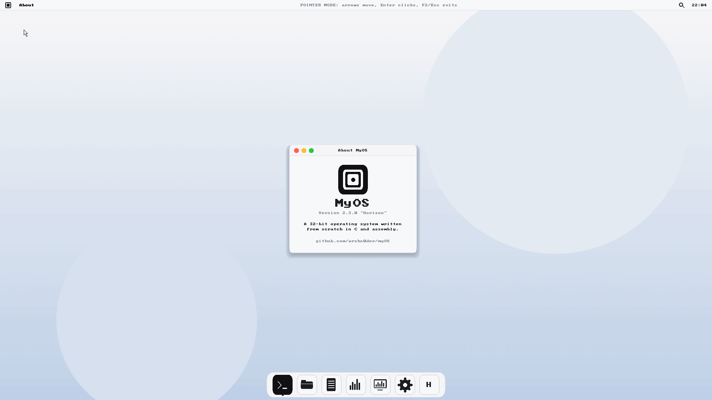
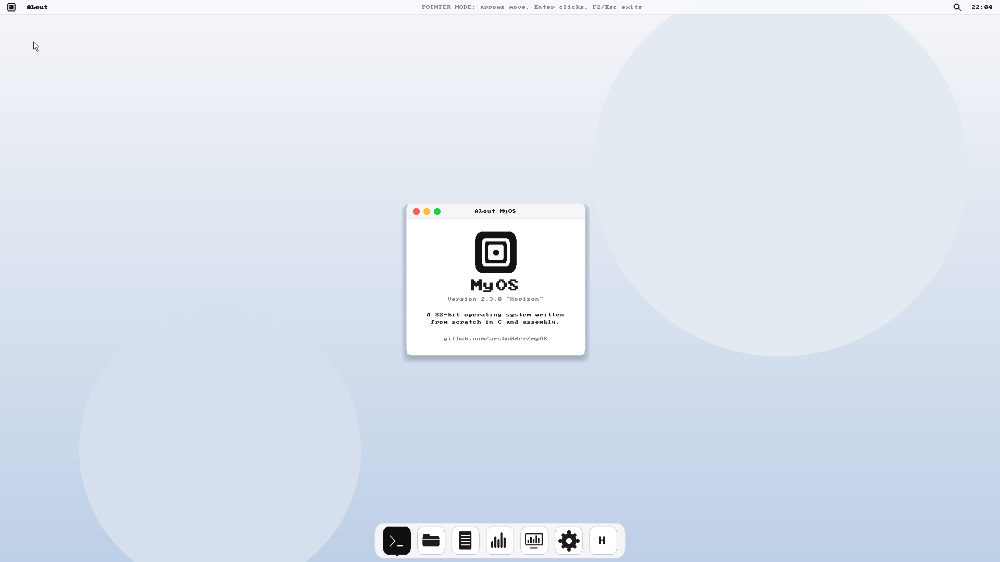
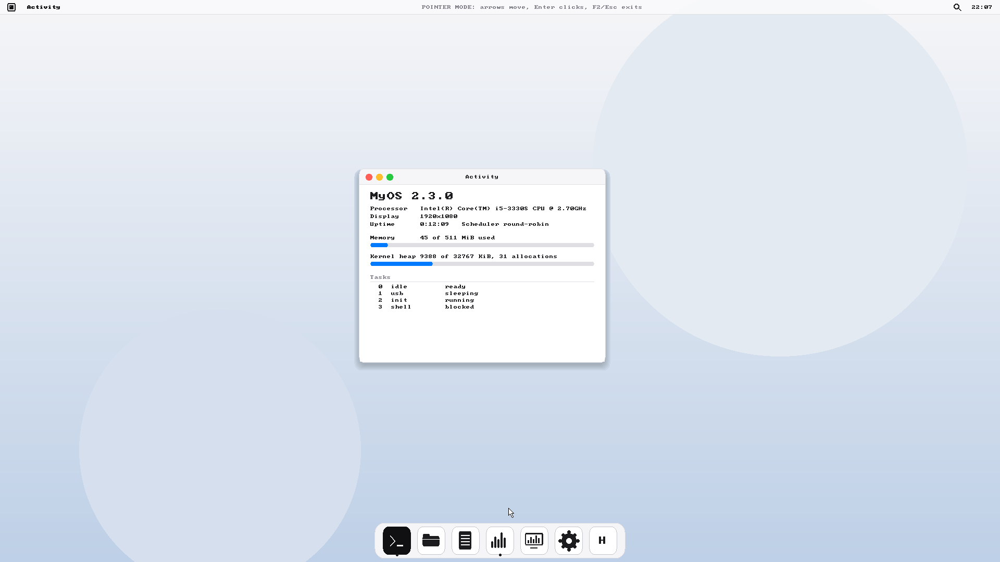
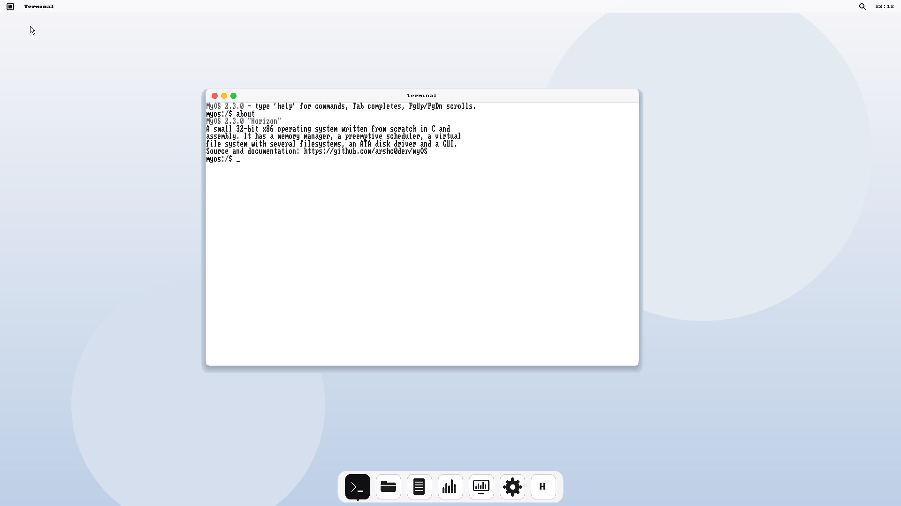
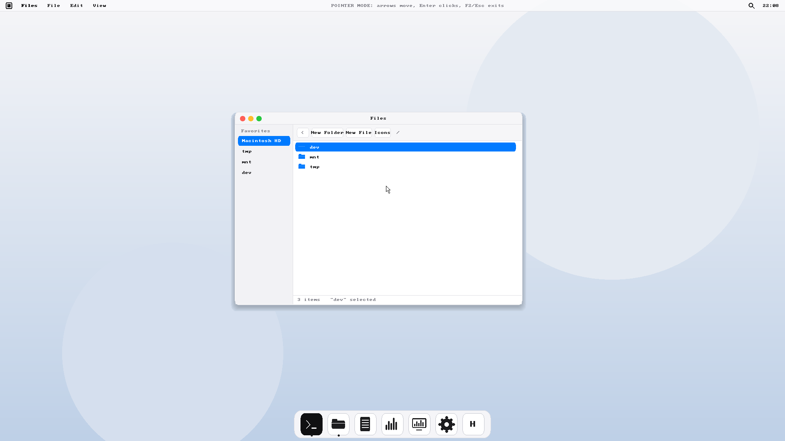
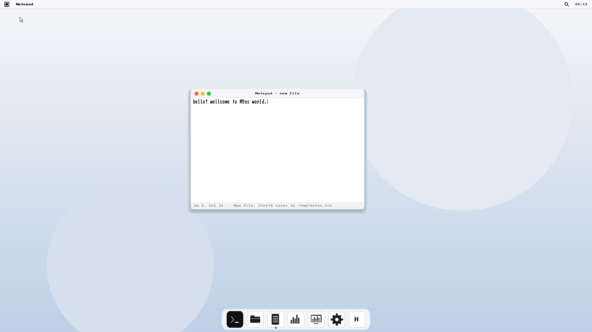
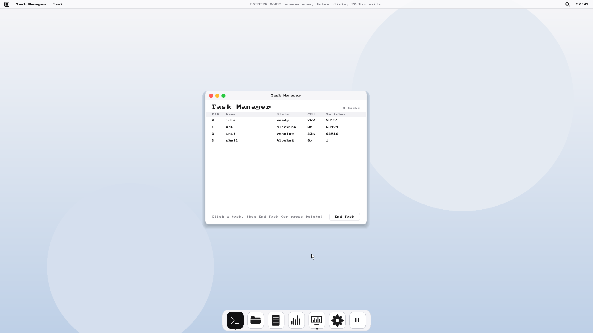
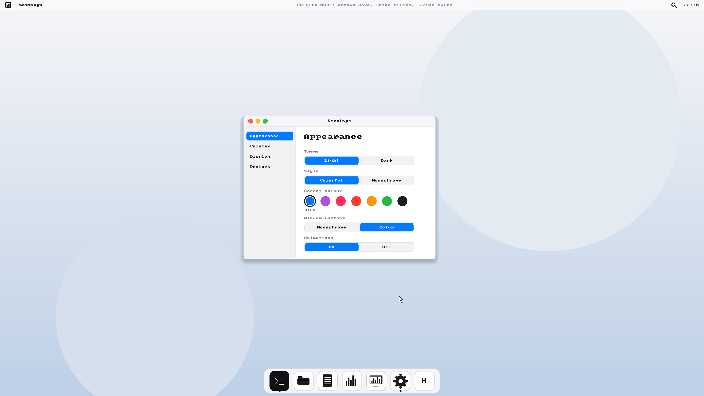

# MyOS 2.10.1 — Horizon

**A hobby operating system built from scratch in C and x86 assembly.**

MyOS is a 32-bit x86 hobby operating system developed to explore kernel engineering, memory management, multitasking, filesystems, device drivers, networking, graphics, and graphical user interfaces.

Built from the ground up, MyOS boots through GRUB using the Multiboot protocol and is organized into modular kernel subsystems. The project combines low-level operating system development with an evolving graphical desktop environment.

The Horizon series focuses on expanding the desktop experience, improving hardware support, and introducing new system capabilities.

       

**Repository:** [arshc0der/myOS](https://github.com/arshc0der/myOS) · **License:** MIT

> **Current release: MyOS 2.7.0**
>
> This release has been compiled but has not been run or runtime-tested. Run `make clean && make` before building.

---

## Table of Contents

- [Overview](#overview)
- [What's New in 2.7.0](#whats-new-in-270)
- [Features](#features)
- [Screenshots and Demo](#screenshots-and-demo)
- [Getting Started](#getting-started)
- [Building MyOS](#building-myos)
- [Running MyOS](#running-myos)
- [Using the Shell](#using-the-shell)
- [Filesystems and Storage](#filesystems-and-storage)
- [Memory Management and Processes](#memory-management-and-processes)
- [Graphics and Desktop](#graphics-and-desktop)
- [Project Structure](#project-structure)
- [Development and Customization](#development-and-customization)
- [Documentation](#documentation)
- [Testing](#testing)
- [Known Limitations](#known-limitations)
- [Troubleshooting](#troubleshooting)
- [Roadmap](#roadmap)
- [Contributing](#contributing)
- [License](#license)

---

## Overview

MyOS started as a small kernel with a text console and an interactive shell. It has gradually evolved into a modular operating system project featuring memory management, process scheduling, filesystem support, hardware drivers, networking, and a graphical desktop.

The project is designed for both experimentation and learning. Its modular architecture makes it possible to explore individual operating system components without treating the kernel as one large, monolithic program.

With MyOS, you can explore:

- How an x86 kernel boots using GRUB and Multiboot.
- How physical and virtual memory are managed.
- How processes and scheduling work.
- How filesystems interact with storage devices.
- How hardware is accessed through device drivers.
- How framebuffer graphics and window management are implemented.
- How networking and system services are developed.

MyOS is an ongoing hobby operating system project. Features are introduced progressively, and their stability and hardware compatibility may vary between releases.

## What's New in 2.7.0

MyOS 2.7.0 expands accessibility, system interaction, networking, and device support.

### Accessibility

- **Screen Magnifier:** A 3x magnification lens displayed beside the pointer.
- **Visual Screen Reader:** A caption bar identifies the window, menu, or dock item under the pointer and displays the active window.
- **Audio Feedback:** Short PC-speaker tones play when the identified interface element changes.

### Assistant App

A new Assistant application is available from the Dock. It accepts typed requests for common system actions and information, including:

- Opening applications.
- Checking the date and time.
- Switching between dark and light appearance.
- Adjusting volume and mute settings.
- Controlling magnification and the screen reader.
- Checking network and update status.
- Restarting and shutting down the system.

The Voice Assistant setting adds a tone to responses.

### Update Detection

- Checks connected disks for the `MyOSUpdate/VERSION` marker.
- Supports manual checks through Settings > General > Check now.
- Can check for updates when Settings starts if the corresponding setting is enabled.
- Notifies the user when a newer kernel is detected.

Copying the updated `kernel.elf` to boot media remains a manual operation.

### Translations

Initial translations are available for setup screens, the login screen, and Settings page names:

- Hindi (Latin letters)
- Spanish
- French
- German
- Portuguese

### Networking

The network stack now includes basic TCP client and HTTP functionality.

New interfaces include:

- `net_tcp_connect`
- `net_tcp_send`
- `net_tcp_recv`
- `net_tcp_close`
- `net_http_get`

The shell also includes the `wget` command for HTTP downloads.

### USB Bluetooth

Initial USB Bluetooth support has been introduced through `src/drivers/usb/btusb.c`.

- Resets and registers a supported USB Bluetooth dongle.
- Performs device inquiry through the Scan action.
- Lists nearby Bluetooth devices and their names when transmitted.

**Important:** MyOS 2.7.0 has only been compiled. These new features have not been runtime-tested.

For the complete release details, see the [MyOS 2.7.0 release notes](https://github.com/arshc0der/myOS/releases).

## Features

The following sections describe the major subsystems present in the MyOS project source tree. Individual capabilities may have different levels of implementation and stability.

### 1. Kernel and Hardware

- 32-bit x86 kernel written in C and assembly.
- GRUB boot support using the Multiboot protocol.
- Global Descriptor Table (GDT).
- Interrupt Descriptor Table (IDT).
- Interrupt service routines.
- Programmable Interrupt Controller (PIC).
- Programmable Interval Timer (PIT).
- CPU information through CPUID.
- PCI device enumeration.
- PS/2 keyboard and mouse input.
- Real-time clock (RTC).
- Serial and VGA console drivers.
- Kernel logging, formatted output, and panic handling.

### 2. Memory Management

- Physical memory management with a bitmap allocator.
- Virtual memory management and paging.
- Kernel heap allocator.
- Memory-related diagnostic interfaces.

### 3. Processes and Synchronization

- Scheduler subsystem with configurable policies.
- Context-switching support.
- Mutexes and semaphores.
- Synchronization primitives.
- Student scheduler implementation.

### 4. Filesystems and Storage

- Virtual filesystem (VFS).
- RAM-based filesystem (ramfs).
- Device filesystem (devfs).
- MyOS filesystem (MyFS).
- Block-device abstraction.
- RAM disks.
- ATA PIO disk driver.
- MBR partition support.
- Filesystem mounting and file operations through the shell.

### 5. Graphics and Desktop

- Framebuffer graphics support.
- Framebuffer-based text console.
- Graphics primitives and terminal grid.
- Graphical user interface subsystem.
- Window management.
- Desktop applications.
- Settings and system configuration.
- Screen magnification and visual accessibility features.

### 6. Networking and Connectivity

- Network stack development.
- Basic TCP client interfaces.
- HTTP GET support.
- Shell-based HTTP downloads through `wget`.
- Initial USB Bluetooth device detection and inquiry.

### 7. Developer Tools

- Modular shell commands.
- Built-in kernel self-tests.
- Host-side test infrastructure.
- Student templates for custom initialization.
- Filesystem and scheduler development templates.
- Architecture and subsystem documentation.

## Screenshots and Demo

Explore the MyOS graphical desktop and its applications.

<p align="center">
  
</p>

<p align="center">
  <strong>Explore the MyOS desktop experience.</strong><br>
  Desktop · Terminal · File Manager · Notepad · Task Manager · Settings
</p>

Additional screenshots:

<details>
<summary>View individual desktop screenshots</summary>

### Desktop Environment



### System Information



### Terminal



### File Manager



### Notepad



### Task Manager



### System Settings



</details>

## Getting Started

### Requirements

A Linux development environment is recommended.

| Tool | Purpose |
|---|---|
| GCC with 32-bit support | Compile kernel code |
| GNU Make | Build automation |
| GNU binutils | Assemble and link the kernel |
| GRUB utilities | Prepare a bootable ISO |
| xorriso | Create the ISO image |
| QEMU | Run and debug MyOS |
| Bochs | Alternative emulator and debugging environment |

The exact toolchain requirements depend on the compiler flags and build targets configured in the Makefile.

### Fedora

Install the commonly required development tools:

```bash
sudo dnf install gcc glibc-devel.i686 make binutils \
  qemu-system-x86 grub2-tools grub2-tools-extra xorriso
```

### Debian / Ubuntu

```bash
sudo apt update

sudo apt install build-essential gcc-multilib binutils make \
  grub-pc-bin xorriso mtools qemu-system-x86
```

If your distribution uses different GRUB package names, install the equivalent packages for your release.

## Building MyOS

### 1. Clone the Repository

```bash
git clone https://github.com/arshc0der/myOS.git
cd myOS
```

### 2. Inspect Available Build Targets

```bash
make help
```

If a `help` target is not available, inspect the Makefile directly:

```bash
grep -nE '^[[:alnum:]_.-]+:' Makefile
```

### 3. Compile the Kernel

```bash
make clean
make
```

The expected kernel output is `kernel.elf`, based on the project's build instructions.

### 4. Build the Bootable ISO

```bash
make iso
```

The expected ISO output is `myos.iso`.

### 5. Run MyOS

```bash
make run
```

Build target names and output paths should be checked against the current Makefile if they differ from these instructions.

## Running MyOS

### QEMU

QEMU provides a convenient way to experiment with MyOS without modifying your host operating system.

A basic launch command is:

```bash
qemu-system-i386 -cdrom myos.iso -m 128M
```

You can experiment with different memory sizes and virtual hardware configurations as kernel support improves.

### VirtualBox and VMware

1. Create a virtual machine configured for a 32-bit x86 guest.
2. Attach the MyOS bootable ISO.
3. Configure the virtual hardware.
4. Boot from the virtual optical drive.

Compatibility depends on the firmware mode and devices exposed to the guest.

### Bochs

Bochs is useful for low-level debugging and examining processor state.

The repository includes configuration and test tools under:

```text
tools/bochs/
```

Review the included configuration files for the expected image paths and launch procedure.

### Real Hardware

Physical hardware compatibility depends on firmware, display initialization, storage controllers, and supported devices.

Test MyOS in a virtual machine first. Back up important data before attempting physical boot experiments.

## Using the Shell

After booting into the text-shell environment, use:

```text
help
```

This displays the commands registered in the running build.

### Core Commands

The following commands are documented in the project:

| Command | Description |
|---|---|
| `help` | List shell commands |
| `about` | Display project information |
| `version` | Display the kernel version |
| `sysinfo` | Show a system summary |
| `meminfo` | Inspect memory information |
| `cpuinfo` | Display CPU details |
| `lspci` | List PCI devices |
| `date` | Display RTC date and time |
| `history` | Show command history |
| `echo <text>` | Print text |
| `clear` | Clear the console |
| `reboot` | Restart the system |
| `halt` | Halt the CPU |
| `shutdown` | Request system shutdown |

Additional filesystem, graphics, and process commands are implemented in separate shell modules:

- `src/shell/cmd_fs.c`
- `src/shell/cmd_gfx.c`
- `src/shell/cmd_proc.c`
- `src/shell/cmd_sys.c`

Use the running shell's `help` output as the authoritative reference for command availability and syntax.

### Example Session

```text
MyOS> help
MyOS> version
MyOS> sysinfo
MyOS> cpuinfo
MyOS> meminfo
MyOS> lspci
```

Actual output depends on the emulator, available memory, virtual hardware, and current kernel build.

## Filesystems and Storage

MyOS separates filesystem operations from storage devices through a virtual filesystem and block-device layer.

The source tree includes RAM-backed storage, device files, an on-disk filesystem implementation, and a student filesystem template.

### Filesystem Components

| Component | Source file | Purpose |
|---|---|---|
| Virtual filesystem | `src/fs/vfs.c` | Filesystem interface and namespace |
| RAM filesystem | `src/fs/ramfs.c` | RAM-backed files |
| Device filesystem | `src/fs/devfs.c` | Device namespace |
| MyFS | `src/fs/myfs.c` | Project-specific filesystem |
| Block devices | `src/fs/blockdev.c` | Block-device abstraction |
| RAM disk | `src/fs/ramdisk.c` | Memory-backed disk |
| Partition support | `src/fs/partition.c` | Partition handling |
| ATA driver | `src/drivers/ata.c` | ATA PIO storage access |

### Example Filesystem Workflow

The following is an illustrative workflow based on the project's earlier shell documentation:

```text
MyOS> lsblk
MyOS> ramdisk create r1 2048
MyOS> mkfs myfs ram0
MyOS> mount ram0 /mnt myfs
MyOS> echo hello > /mnt/a.txt
MyOS> cat /mnt/a.txt
MyOS> df
```

Device names, mount syntax, formatting support, and shell redirection behavior depend on the implementation in the current build. Check `help` before using these commands.

For filesystem implementation details, see `docs/WRITING_A_FILESYSTEM.md`.

## Memory Management and Processes

### Memory Management

Memory management code is located in `src/mm/`.

| File | Responsibility |
|---|---|
| `pmm.c` | Physical memory management |
| `vmm.c` | Virtual memory management |
| `heap.c` | Kernel heap allocation |

Related interfaces are declared in `include/`.

### Scheduling and Synchronization

The process subsystem is located in `src/proc/`.

| File | Responsibility |
|---|---|
| `sched.c` | Scheduling implementation |
| `sync.c` | Synchronization primitives |
| `src/arch/i386/switch.S` | Architecture-specific context switching |
| `src/user/my_scheduler.c` | Student scheduler implementation |

For more information, see `docs/PROCESSES_AND_SCHEDULING.md`.

## Graphics and Desktop

The graphics subsystem is organized into dedicated modules.

| File | Responsibility |
|---|---|
| `src/gfx/framebuffer.c` | Framebuffer handling |
| `src/gfx/fbcon.c` | Framebuffer console |
| `src/gfx/font.c` | Font rendering |
| `src/gfx/gfx.c` | Graphics operations |
| `src/gfx/tgrid.c` | Terminal grid |
| `src/gui/gui.c` | Graphical user interface |

Related interfaces are located in `include/`.

### Desktop Keyboard Shortcuts

The following shortcuts are described in the earlier desktop documentation. Their availability may depend on the current GUI build.

| Shortcut | Action |
|---|---|
| `Alt+T` | Open Terminal |
| `Alt+F` | Open Files |
| `Alt+I` | Open System Info |
| `Alt+N` | Open Notepad |
| `Alt+A` | Open About |
| `Alt+Tab` | Switch windows |
| `Alt+W` | Close a window |
| `Alt+M` | Open the Start menu |
| `Alt+Q` | Return to the text shell |

Application-specific shortcuts may also be available.

## Project Structure

MyOS uses a modular source layout to separate public interfaces, kernel implementations, architecture-specific code, documentation, and tests.

```text
myOS/
├── docs/
│   ├── ARCHITECTURE.md
│   ├── GUI_ROADMAP.md
│   ├── PROCESSES_AND_SCHEDULING.md
│   └── WRITING_A_FILESYSTEM.md
├── include/                 # Kernel headers and interfaces
├── iso/
│   └── boot/grub/
│       └── grub.cfg         # GRUB boot menu
├── src/
│   ├── arch/i386/           # GDT, IDT, PIC, context switching
│   ├── boot/                # Assembly boot entry
│   ├── drivers/             # Hardware drivers
│   ├── fs/                  # VFS, MyFS, ramfs, devfs, storage
│   ├── gfx/                 # Framebuffer, font, graphics
│   ├── gui/                 # Graphical interface
│   ├── kernel/              # Kernel entry, console, panic, logging
│   ├── lib/                 # Kernel utility functions
│   ├── mm/                  # Physical and virtual memory
│   ├── proc/                # Scheduling and synchronization
│   ├── shell/               # Shell and command modules
│   ├── test/                # Kernel self-tests
│   └── user/                # Student extension implementations
├── templates/               # Student starter templates
├── tests/
│   └── host/                # Host-side test infrastructure
├── tools/
│   └── bochs/               # Bochs configuration and test tools
├── linker.ld                # Kernel linker script
├── Makefile                 # Build system
├── LICENSE
└── README.md
```

## Development and Customization

MyOS includes starter files for experimenting with the kernel and implementing custom functionality.

### Student Extension Points

| File | Purpose |
|---|---|
| `src/user/user_init.c` | Custom initialization and user-defined shell commands |
| `src/user/studentfs.c` | Student filesystem implementation |
| `src/user/my_scheduler.c` | Student scheduler policy |
| `templates/user_init.c` | Initialization starter template |
| `templates/studentfs.c` | Filesystem development template |
| `templates/my_scheduler.c` | Scheduling starter template |

### Suggested Learning Path

1. Clone and build MyOS.
2. Boot it in QEMU.
3. Explore the system through the shell.
4. Read `docs/ARCHITECTURE.md` to understand the kernel structure.
5. Experiment with `src/user/user_init.c`.
6. Study `src/fs/` before implementing filesystem functionality.
7. Read `docs/WRITING_A_FILESYSTEM.md`.
8. Explore `src/proc/` and the scheduler implementation.
9. Run the available tests after making changes.

## Documentation

The `docs/` directory contains guides for major project subsystems.

| Document | Description |
|---|---|
| `ARCHITECTURE.md` | Kernel architecture and subsystem design |
| `GUI_ROADMAP.md` | Graphical interface development plans |
| `PROCESSES_AND_SCHEDULING.md` | Process and scheduler design |
| `WRITING_A_FILESYSTEM.md` | Filesystem development guide |

Documentation should be updated whenever the corresponding implementation or supported interfaces change.

## Testing

MyOS includes kernel self-test sources and host-side test infrastructure.

Relevant files include:

```text
src/test/selftest.c
src/test/selftest_fs.c
src/test/selftest_gfx.c
src/test/selftest_shell.c
tests/host/Makefile
```

### Kernel Tests

If the current kernel exposes a `selftest` command, run it from the MyOS shell:

```text
MyOS> selftest
```

### Host-Side Tests

Inspect the host test Makefile and run its available targets:

```bash
make -C tests/host
```

The existence of test source files does not guarantee that every test passes.

**MyOS 2.7.0 testing status:** The release has been compiled but has not been run or runtime-tested. Runtime compatibility and behavior of its features have not yet been verified.

## Known Limitations

MyOS is an actively developed hobby operating system. Some subsystems are experimental or have limited hardware support.

### MyOS 2.7.0 Limitations

- **Wi-Fi:** No Wi-Fi driver is available. Wi-Fi chipsets require vendor firmware and dedicated drivers. Ethernet should be used instead.
- **Bluetooth:** Initial USB dongle detection and scanning are available, but pairing, Bluetooth audio, and Bluetooth mouse support are not implemented.
- **Speech:** The screen reader and Assistant do not have a speech engine. The screen reader uses visual captions and PC-speaker tones.
- **Microphone:** Microphone input is not supported.
- **Automatic updates:** Update detection is available, but automatic downloading and installation are not implemented. Kernel replacement remains manual.
- **HTTPS:** The current HTTP functionality does not support HTTPS.
- **TCP reliability:** Only one connection at a time is supported, and retransmission handling is not implemented.
- **Translations:** Translation coverage is limited to setup screens, login, and Settings page names. Other menus and applications remain in English.
- **CJK fonts:** Japanese and Chinese interfaces fall back to English because CJK font support is unavailable.

Other hardware and subsystem limitations may apply depending on the build and emulator configuration.

## Troubleshooting

### GRUB Cannot Find or Load the Kernel

Check that the ISO contains the kernel at the path configured in `iso/boot/grub/grub.cfg`.

Rebuild the kernel and ISO:

```bash
make clean
make
make iso
```

### GRUB Utilities Are Missing

Install the GRUB utilities for your Linux distribution.

If available, check the kernel's Multiboot format:

```bash
grub-file --is-x86-multiboot kernel.elf
```

Some distributions provide `grub2-file` instead.

### The Desktop Does Not Appear

- Check the GRUB boot menu.
- Confirm that the graphical option is enabled in the current build.
- Try the text-shell option to distinguish a graphics issue from a general boot failure.

### ATA Disks Are Unavailable

Check whether the virtual machine exposes a compatible IDE/ATA device and whether the disk driver and block-device registration are initialized.

A RAM disk may be an alternative when supported by the current build.

### Keyboard or Mouse Input Does Not Work

Verify the virtual machine's input-device configuration and the current PS/2 driver support.

Device behavior can differ between QEMU, Bochs, VirtualBox, VMware, and UEFI-based environments.

### Network or Bluetooth Features Do Not Work

Remember that MyOS 2.7.0 has not been runtime-tested. Network and Bluetooth support also have the limitations described above. Check the available drivers and device compatibility before troubleshooting individual applications.

## Roadmap

Potential areas for future development include:

- Improving kernel robustness and error reporting.
- Expanding filesystem functionality and storage compatibility.
- Extending scheduler policies and synchronization primitives.
- Improving graphics, window management, and desktop usability.
- Adding Wi-Fi driver support.
- Expanding Bluetooth functionality, including pairing and audio.
- Improving TCP reliability and adding HTTPS support.
- Developing speech output and microphone support.
- Expanding automatic update functionality.
- Extending translation coverage and font support.
- Improving automated testing and emulator coverage.
- Expanding debugging tools and kernel diagnostics.

These are development directions, not promises of inclusion in a particular release.

## Contributing

Contributions, bug reports, documentation improvements, and new ideas are welcome.

To contribute:

1. Explore the existing source code and documentation.
2. Open an issue before making a large architectural change.
3. Keep changes focused on a specific subsystem.
4. Build and test your changes where possible.
5. Include reproducible steps and actual test results in bug reports and pull requests.

When reporting bugs, include:

- MyOS version.
- Emulator or physical hardware used.
- Firmware mode and virtual hardware configuration.
- Build commands.
- Steps to reproduce the issue.
- Relevant logs and observed behavior.

**Repository:** [github.com/arshc0der/myOS](https://github.com/arshc0der/myOS)

## License

MyOS is released under the **MIT License**.

See the [LICENSE](LICENSE) file for the complete license terms.

---

**MyOS 2.7.0 — Exploring operating system development, one subsystem at a time.**
